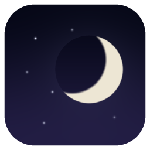
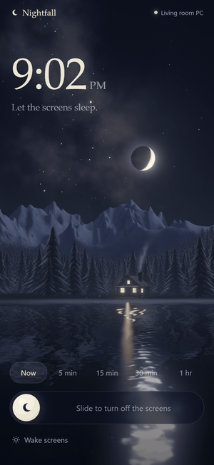
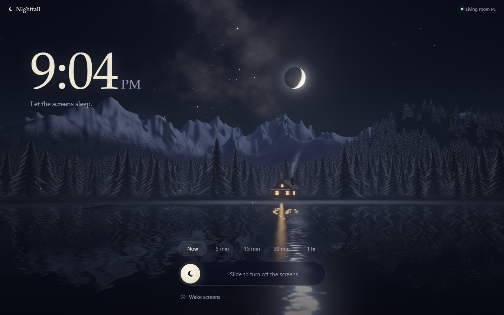
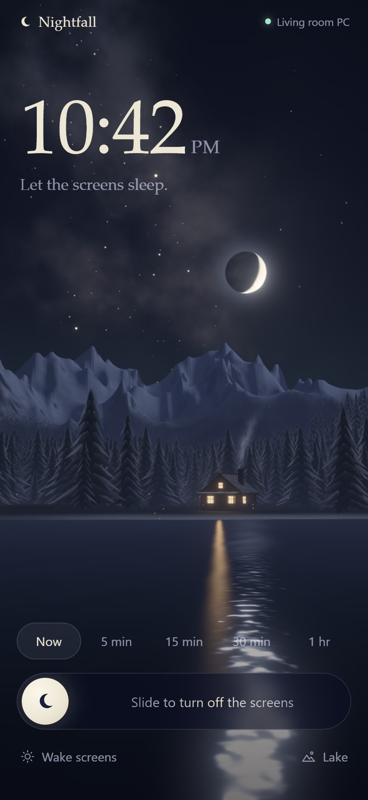
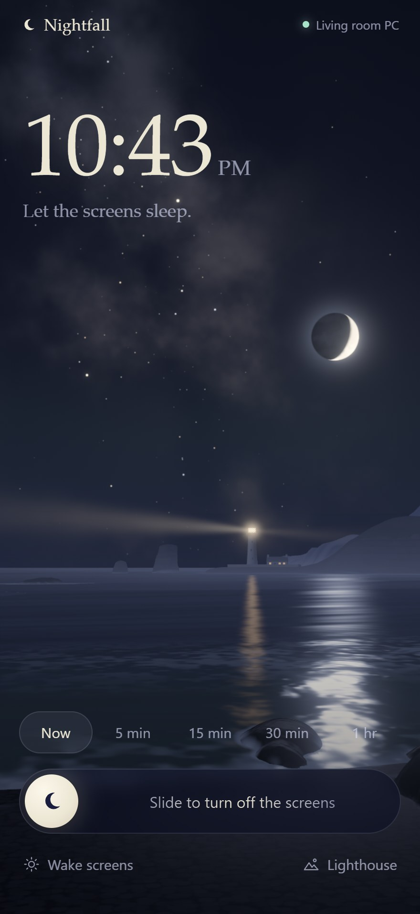
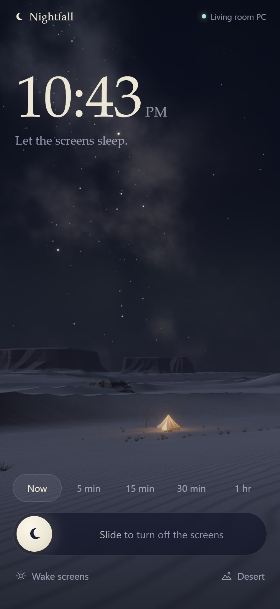
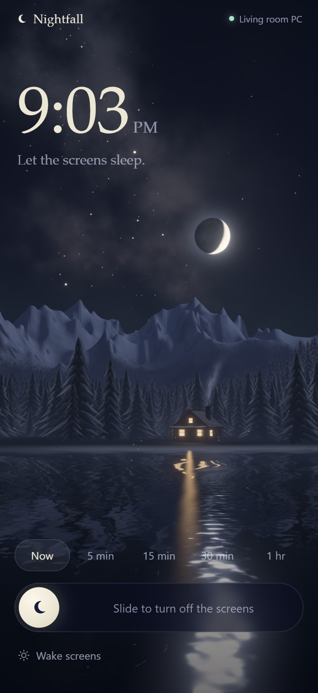
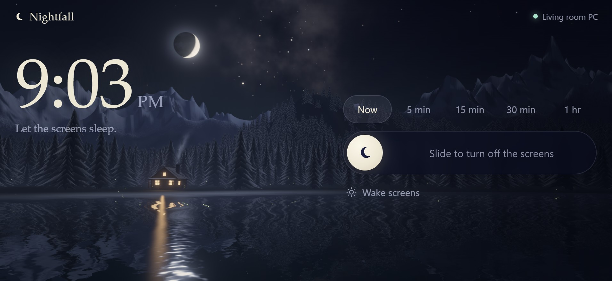

<div align="center">



# Nightfall

**Turn your PC's screens off from your phone.**<br>
A bedtime remote for Windows, over your home Wi-Fi or Tailscale.

[](https://github.com/quorraa/Nightfall/releases/latest)
[](#install)
[](LICENSE)

<table>
  <tr>
    <td rowspan="2" align="center" valign="middle">
      <br>
      <sub>On a phone</sub>
    </td>
    <td align="center" valign="middle">
      <br>
      <sub>On its side</sub>
    </td>
  </tr>
  <tr>
    <td align="center" valign="middle">
      <br>
      <sub>In a desktop browser</sub>
    </td>
  </tr>
</table>

</div>

Nightfall sends the same signal Windows sends when "Turn off the display after N minutes" runs
out, so your monitors sleep but stay connected, and wake the moment you touch the mouse or
keyboard. On your phone, a night scene stands in for your PC: its light goes out with your screens.

It's one small program with the page built in. There's no runtime to install, no account and no
cloud: your phone talks straight to your PC.

## Install

1. Download `nightfall.exe` from the [latest release](https://github.com/quorraa/Nightfall/releases/latest)
   and double-click it.
2. Choose **Install**. Windows asks for permission once.
3. Open the address it shows on your phone. To keep it on your Home Screen like an app:
   - **iPhone**: Safari's Share menu › Add to Home Screen.
   - **Android**: Chrome only installs apps from an `https://` address, so first open
     `http://<your-pc>:39847/setup` (or **Scenes › Install as app**). It has your phone trust your
     PC once, then opens `https://<your-pc>:39847`, where Chrome's menu › Add to Home screen ›
     **Install** works. With [Tailscale](#away-from-home) you can skip that setup.

> [!NOTE]
> Nightfall isn't code-signed yet, so the first time you run it Windows may say "Windows protected
> your PC". Choose **More info**, then **Run anyway**.

Installing puts Nightfall in `C:\Program Files\Nightfall`, starts it in the background each time
you sign in (and again if it ever stops), and opens port **39847** in Windows Firewall for your
home network only. Opening a newer `nightfall.exe` offers to update.

### Away from home

With [Tailscale](https://tailscale.com) on both devices, run this once on the PC:

```powershell
tailscale serve --bg --https=39847 http://127.0.0.1:39847
```

Your phone can then use `https://<your-pc>.<your-tailnet>.ts.net:39847`, which Nightfall shows
alongside the home address.

> [!TIP]
> The Tailscale address makes https seamless: its certificate is one every phone already trusts,
> so there's no certificate to install and Chrome on Android offers **Install** straight away. It
> only works while Tailscale is connected on both ends, the PC and the phone. With either one
> off, use the home address instead.

## Using it

**On your phone**, slide to turn the screens off now, or pick 5, 15, 30 minutes or an hour and
watch the light burn down. **Wake screens** turns them back on from bed. The button in the corner
switches between the scenes, and your phone remembers the one you chose.

**On the PC**, open **Nightfall** from the Start menu. It shows whether Nightfall is running and the
addresses to open on your phone, and lets you:

- open it in this PC's browser,
- stop it or start it again,
- change the port, if another program needs 39847,
- remove it (or use **Settings › Apps**).

## Scenes

<table>
  <tr>
    <td align="center" width="33%">
      <br>
      <b>Lake</b><br>
      <sub>A cabin across still water under the peaks. Fireflies, and an aurora after lights-out.</sub>
    </td>
    <td align="center" width="33%">
      <br>
      <b>Lighthouse</b><br>
      <sub>A beam turning through the sea haze, a keeper's cottage, a long swell up the shingle.</sub>
    </td>
    <td align="center" width="33%">
      <br>
      <b>Desert</b><br>
      <sub>A lantern-lit bell tent in the hollow of the dunes, embers in a fire ring, mesas beyond.</sub>
    </td>
  </tr>
</table>

<details>
<summary><b>Before and after lights-out</b></summary>
<br>

<table>
  <tr>
    <th></th>
    <th>Before</th>
    <th>After</th>
  </tr>
  <tr>
    <td>Phone</td>
    <td align="center"></td>
    <td align="center"></td>
  </tr>
  <tr>
    <td>On its side</td>
    <td align="center"></td>
    <td align="center"></td>
  </tr>
  <tr>
    <td>Desktop</td>
    <td align="center"></td>
    <td align="center"></td>
  </tr>
</table>

</details>

## How it works

Nightfall is written in Rust with no crates, just the standard library and Windows itself. It runs
in your desktop session rather than as a service, because a Windows service lives in session 0
and can't reach the monitors. It puts them to sleep with `SC_MONITORPOWER`.

<details>
<summary><b>Keeping the screens off</b></summary>
<br>

- Programs that ask Windows for the display (video, streaming, remote tools) can switch it back on.
  If that happens with no keyboard or mouse input, Nightfall turns the screens off again, up to 30
  times a night, and logs it.
- It also ignores a mouse that only twitches (a bump to the desk, a jittery sensor). If nothing but
  a movement of 10 counts or less (a few pixels) woke the screens, they go off again. That happens
  at most 5 times a night and never twice within 30 seconds, so a second touch of the mouse always
  wakes them.
- A key, click, scroll, a real movement, touch, pen or a remote pointer always wakes them at once,
  and so does any input Nightfall can't see.

</details>

<details>
<summary><b>Who can reach it</b></summary>
<br>

- Only loopback, private home-network and Tailscale addresses get an answer.
- Requests that change anything must be JSON from the page's own origin, so another website open
  in a browser can't trigger them.
- The firewall rule only lets in devices on your local network.
- http and https share one port. For https, Nightfall makes its own certificate authority, which
  can only vouch for home-network addresses (`10.x`, `172.16-31.x`, `192.168.x` and `.local`
  names), and a certificate for this PC from it. It reissues that certificate when the PC's
  addresses change. The keys stay in Windows' key storage, can't be exported, and are removed
  with Nightfall. TLS is Windows' own (SChannel), TLS 1.2 and 1.3.

The API:

| Request | Does |
| --- | --- |
| `GET /api/status` | Whether a timer is set and what happened last |
| `POST /api/dim {"delay": seconds}` | Turn the screens off now (0) or after a delay, up to 6 hours |
| `POST /api/cancel` | Cancel the timer |
| `POST /api/wake` | Wake the screens with a 1 px mouse nudge |
| `GET /nightfall.crt` | The certificate authority phones install for https (`/setup` explains how) |

</details>

<details>
<summary><b>The page</b></summary>
<br>

three.js r185 (vendored in `web/vendor`), WebGL2, every shader hand-written. The light in each
scene stands for your screens: dragging the slider dims it, a timer burns it down, lights-out
switches it off, and over the next half minute more stars and the Milky Way come out as your eyes
adjust and a shooting star crosses.

- `web/scene.js`: loads the chosen scene and fades between them; camera framing for portrait,
  phone-landscape and desktop; the lights-out choreography; an adaptive pixel budget that lowers
  resolution if frames get slow; 30 fps at night.
- `web/scenes/`: one module per scene (`index.js` lists them); each builds its own land, water or
  sand and says where its light is.
- `web/gl/sky.js`: sky dome, a Milky Way baked once into a texture, 22k stars, a crescent moon with
  earthshine, aurora, shooting stars.
- `web/gl/land.js`: terrain with snow and rock, about 7,500 instanced spruce, fir and pine in three
  detail tiers, the log cabin, chimney smoke.
- `web/gl/water.js`: six waves plus fine catspaws, a real mirrored reflection pass, glitter on the
  moon's path, the lamp's path, ripples, fireflies.
- `web/gl/post.js`: half-float HDR with 4x MSAA, bloom, exposure, night-vision blue shift, tone
  mapping, vignette, dither.

Debug URL options: `?seed=N`, `?freeze=SECONDS`, `?night=1`, `?q=low`, `?msaa=0`, `?fps`,
`?scene=lake|coast|dunes`, `?debug=nopost|bloom|refl|water|forest`, `?capture`.

</details>

<details>
<summary><b>Every screen size</b></summary>
<br>

The layout is checked on 47 screen sizes, from a 280 px folding-phone cover screen through every
current iPhone, Pixel and Galaxy size, foldables and iPads in both orientations, to laptops,
1080p, 1440p, ultrawide and 4K monitors. With a test server running, open
`http://127.0.0.1:39848/dev/devices.html` (add `?scene=coast` or `?scene=dunes` for the others).

It loads the page at each size with the longest text it can show (a long PC name, an error
message) and that device's notch and home-bar insets, in every mode and with the scene sheet
open, and lists anything off screen, clipped, overlapping, under the notch, too small to tap, or
hiding the light.

</details>

<details>
<summary><b>Options and logs</b></summary>
<br>

- `nightfall.exe --install 40000` installs on another port from a terminal.
- `nightfall.exe --port 39848 --dry-run` runs a test copy next to the real one that logs instead of
  touching the screens. `NIGHTFALL_PORT` and `NIGHTFALL_DRY_RUN=1` do the same.
- `NIGHTFALL_WEB=<folder>` serves the page from another folder instead of the copy built in.
- The log is `logs\nightfall.log` next to the program, or `%LOCALAPPDATA%\Nightfall\logs` when that
  folder can't be written (as in Program Files). The manage window links to it.
- The certificate authority's certificate is `%LOCALAPPDATA%\Nightfall\tls\nightfall-ca.crt`.

</details>

## Build from source

With [Rust](https://rustup.rs): `cargo build --release` makes `target\release\nightfall.exe`.

- `cargo test` runs the unit tests.
- `cargo test -- --ignored raw_input` checks that raw mouse input arrives (it moves the pointer
  3 px and back).
- `cargo test -- --ignored task_scheduler` checks that Task Scheduler accepts the sign-in task (it
  adds a test task and deletes it).
- `tools/make_icon.py` draws the icons in `assets/` and `web/icon-180.png`.
- `tools/capture.py` records the GIFs and pictures above (`--scenes` for just the scene row), and
  `tools/shot.py` takes screenshots, with headless Chromium through Playwright for Python. They're
  development tools; Nightfall itself doesn't need Python.

## License

MIT, see [LICENSE](LICENSE). `web/vendor/` is three.js, © 2010-2026 Three.js Authors, also MIT.
