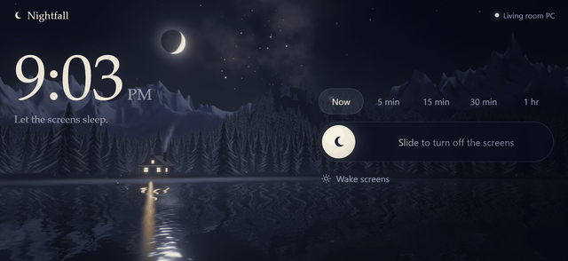
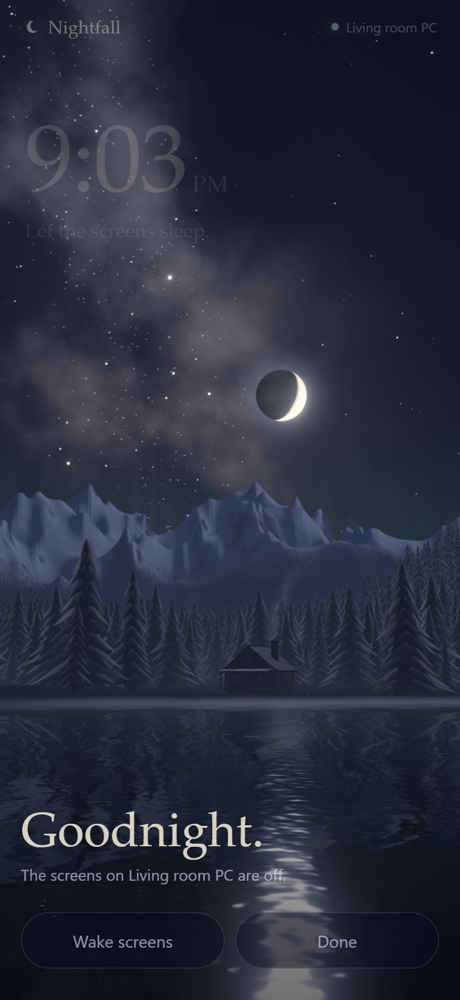
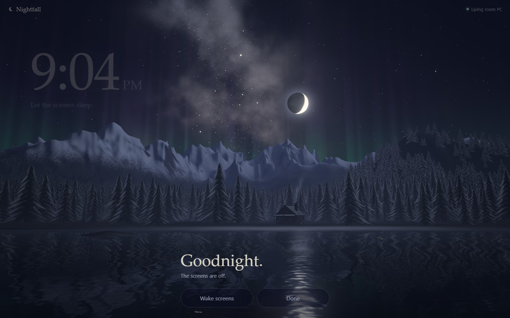

# Nightfall

Turn this PC's monitors off from your phone. It sends the same signal Windows sends when
"Turn off the display after N minutes" runs out (`SC_MONITORPOWER`), so the displays sleep but
stay connected, and wake on any mouse or keyboard input.

  
  &nbsp;
  

  
  
  

  
  

Requirements: Windows 10 or 11. Nightfall is one small `nightfall.exe` with the page built in;
there is no runtime to install. Get it from the
[latest release](https://github.com/quorraa/Nightfall/releases/latest), or build it from this
repository with [Rust](https://rustup.rs). When it's installed it shows both addresses below.

- Port **39847**, chosen to stay clear of common ports (Sunshine uses 47984–48010).
- Home network: `http://<your-pc-ip>:39847`
- Tailscale: `https://<your-pc>.<your-tailnet>.ts.net:39847`. This goes through a `tailscale serve`
  route that forwards to `http://127.0.0.1:39847`. Set it up with
  `tailscale serve --bg --https=39847 http://127.0.0.1:39847`
- On iPhone: open the Tailscale URL in Safari → Share → Add to Home Screen.

## Install

Double-click `nightfall.exe` and choose **Install**. Windows asks once for permission (UAC), then
Nightfall:

- copies itself to `C:\Program Files\Nightfall`,
- adds a sign-in task that starts it with no window and restarts it if it stops,
- opens port 39847 in Windows Firewall for your home network only,
- adds itself to **Settings › Apps**, which is where you remove it.

Opening `nightfall.exe` again shows whether it's running and its addresses. Opening a newer
version offers to update. To install on another port: `.\nightfall.exe --install 40000`.

To try it without touching the screens, run a test copy on port 39848 next to the real one:
`.\nightfall.exe --port 39848 --dry-run`

## Build

`cargo build --release` makes `target\release\nightfall.exe`. `cargo test` runs the unit tests;
`cargo test -- --ignored raw_input` also checks that raw mouse input arrives (it moves the pointer
3 px and back), and `cargo test -- --ignored task_scheduler` checks that Task Scheduler accepts the
sign-in task (it adds a test task and deletes it). `tools/make_icon.py` draws the icons in
`assets/` and `web/icon-180.png`.

## How it works

- `nightfall.exe` is written in Rust (`src/`) with no crates: just the standard library and Windows
  itself. It runs in your desktop session because a Windows service lives in session 0 and can't
  reach the monitors. It serves `web/` from next to the .exe when that folder is there, and the
  copy built into the .exe otherwise.
  - `GET /api/status`
  - `POST /api/dim {"delay": seconds}`: 0 means now, up to 6 h
  - `POST /api/cancel`
  - `POST /api/wake`: a 1 px mouse nudge
- After turning the screens off it watches the display state. Programs that ask Windows for the
  display (video, streaming, remote tools) can switch it back on; if that happens with no keyboard or
  mouse input, Nightfall turns the screens off again (up to 30 times a night) and logs it.
- It also ignores a mouse that only twitches (a bump to the desk, a jittery sensor): if nothing
  but a movement of 10 counts or less (a few pixels) woke the screens, they go off again. That
  happens at most 5 times a night and never twice within 30 seconds, so a second touch of the mouse
  always wakes them. A key, click, scroll, a real movement, touch, pen or a remote pointer always
  wakes them at once, and so does any input it can't see.
- Only loopback, private LAN and Tailscale addresses get an answer. POSTs must be JSON and same-origin, so
  another website open in a browser can't trigger them.
- `web/` is the page. A light in the scene stands for your screens: dragging the slider dims it, a
  timer burns it down, lights-out switches it off, and over the next half minute more stars and the
  Milky Way come out as your eyes adjust and a shooting star crosses.
- Log: `logs\nightfall.log` next to the .exe, or `%LOCALAPPDATA%\Nightfall\logs` when that
  folder can't be written (as in Program Files).
- Options: `--port N` (or `NIGHTFALL_PORT`), `--dry-run` (or `NIGHTFALL_DRY_RUN=1`) to log
  instead of acting, `NIGHTFALL_WEB=<folder>` to serve the page from another folder.

## The scenes

Pick one from the button beside "Wake screens"; the phone remembers it.

- **Lake**: a cabin across still water under the peaks, with fireflies and an aurora after lights-out.
- **Lighthouse**: a beam turning through the sea haze from a point across a bay, a keeper's cottage,
  a long swell running up the shingle.
- **Desert**: a lantern-lit bell tent in the hollow of the dunes, with embers in a fire ring and
  mesas on the horizon.

three.js r185 (vendored in `web/vendor`), WebGL2, every shader hand-written.

- `web/scene.js`: loads the chosen scene and fades between them; camera framing for portrait,
  phone-landscape and desktop; the lights-out choreography; an adaptive pixel budget that lowers
  resolution if frames get slow; 30 fps at night.
- `web/scenes/`: one module per scene (`index.js` lists them); each builds its own land, water or
  sand and says where its light is.
- `web/gl/sky.js`: sky dome, a Milky Way baked once into a texture, 22k stars, a crescent moon with
  earthshine, aurora, shooting stars (built on the CPU so nothing can divide by zero on the GPU).
- `web/gl/land.js`: polar terrain with snow and rock, about 7,500 instanced spruce, fir and pine in
  three detail tiers, the log cabin, chimney smoke.
- `web/gl/water.js`: the lake. Six waves plus fine catspaws, a real mirrored reflection pass, glitter
  on the moon's path, the lamp's path, ripples, fireflies.
- `web/gl/post.js`: half-float HDR with 4x MSAA, bloom, exposure, night-vision blue shift, tone
  mapping, vignette, dither.

Debug URL options: `?seed=N`, `?freeze=SECONDS`, `?night=1`, `?q=low`, `?msaa=0`, `?fps`,
`?scene=lake|coast|dunes`, `?debug=nopost|bloom|refl|water|forest`, `?capture`.

### Devices

The layout is checked on 47 screen sizes, from a 280 px folding-phone cover screen through every
current iPhone, Pixel and Galaxy size, foldables and iPads in both orientations, to laptops,
1080p, 1440p, ultrawide and 4K monitors. With a test server running, open
`http://127.0.0.1:39848/dev/devices.html` (add `?scene=coast` or `?scene=dunes` for the others).
It loads the page at each size with the longest text it can show (a long PC name, an error message)
and that device's notch and home-bar insets, in every mode and with the scene sheet open, and lists
anything off screen, clipped, overlapping, under the notch, too small to tap, or hiding the light.

`tools/capture.py` records the GIFs and pictures above, and `tools/shot.py` takes screenshots, with
headless Chromium through Playwright for Python. They're development tools; Nightfall itself
doesn't need Python.

## License

MIT, see [LICENSE](LICENSE). `web/vendor/` is three.js, © 2010-2026 Three.js Authors, also MIT.
