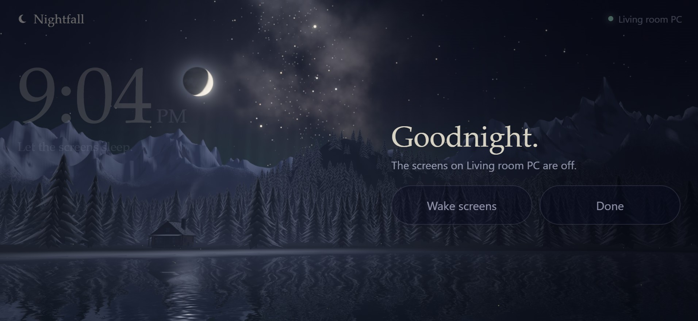

# Nightfall

Turn this PC's monitors off from your phone. It sends the same signal Windows sends when
"Turn off the display after N minutes" runs out (`SC_MONITORPOWER`), so the displays sleep but
stay connected, and wake on any mouse or keyboard input.

<p align="center">
  
  &nbsp;
  
</p>

<p align="center">
  
  
  
</p>
<p align="center">
  
  
</p>

Requirements: Windows 10 or 11 and Python 3.9 or newer, with `pythonw.exe` on your PATH. No packages
to install. `install.ps1` prints both addresses below when it finishes.

- Port **39847**, chosen to stay clear of common ports (Sunshine uses 47984–48010).
- Home network: `http://<your-pc-ip>:39847`
- Tailscale: `https://<your-pc>.<your-tailnet>.ts.net:39847`. This goes through a `tailscale serve`
  route that forwards to `http://127.0.0.1:39847`. Set it up with
  `tailscale serve --bg --https=39847 http://127.0.0.1:39847`
- On iPhone: open the Tailscale URL in Safari → Share → Add to Home Screen.

## Run

```powershell
.\install.ps1     # logon task (windowless, auto-restart) + LAN firewall rule; asks for UAC once
.\uninstall.ps1   # removes both
```

To try it without touching the screens, run a test copy on port 39848 next to the real one:
`$env:NIGHTFALL_DRY_RUN='1'; $env:NIGHTFALL_PORT='39848'; python server.py`

## How it works

- `server.py` is Python standard library only. It runs in your desktop session because a Windows
  service lives in session 0 and can't reach the monitors.
  - `GET /api/status`
  - `POST /api/dim {"delay": seconds}`: 0 means now, up to 6 h
  - `POST /api/cancel`
  - `POST /api/wake`: a 1 px mouse nudge
- After turning the screens off it watches the display state. Programs that ask Windows for the
  display (video, streaming, remote tools) can switch it back on; if that happens with no keyboard or
  mouse input, Nightfall turns the screens off again (up to 30 times a night) and logs it.
- It also ignores a mouse that only twitches (a bump to the desk, a jittery sensor): if nothing
  but a movement of 10 counts or less (a few pixels) woke the screens, they go off again. That
  happens at most 5 times a night and never twice within 30 seconds, so a second touch of the mouse
  always wakes them. A key, click, scroll, a real movement, touch, pen or a remote pointer always
  wakes them at once, and so does any input it can't see.
- Only loopback, private LAN and Tailscale addresses get an answer. POSTs must be JSON and same-origin, so
  another website open in a browser can't trigger them.
- `web/` is the page. The cabin's lamp is the state of your screens: dragging the slider dims it, a
  timer burns it down, lights-out switches it off, and over the next half minute more stars and the
  Milky Way come out as your eyes adjust, a shooting star crosses, and an aurora rises behind the peaks.
- Log: `logs/nightfall.log`

## The scene

three.js r185 (vendored in `web/vendor`), WebGL2, every shader hand-written.

- `web/scene.js`: camera framing for portrait, phone-landscape and desktop; the lights-out
  choreography; an adaptive pixel budget that lowers resolution if frames get slow; 30 fps at night.
- `web/gl/sky.js`: sky dome, a Milky Way baked once into a texture, 22k stars, a crescent moon with
  earthshine, aurora, shooting stars (built on the CPU so nothing can divide by zero on the GPU).
- `web/gl/land.js`: polar terrain with snow and rock, about 7,500 instanced spruce, fir and pine in
  three detail tiers, the log cabin, chimney smoke.
- `web/gl/water.js`: the lake. Six waves plus fine catspaws, a real mirrored reflection pass, glitter
  on the moon's path, the lamp's path, ripples, fireflies.
- `web/gl/post.js`: half-float HDR with 4x MSAA, bloom, exposure, night-vision blue shift, tone
  mapping, vignette, dither.

Debug URL options: `?seed=N`, `?freeze=SECONDS`, `?night=1`, `?q=low`, `?msaa=0`, `?fps`,
`?debug=nopost|bloom|refl|water|forest`, `?capture`.

### Devices

The layout is checked on 47 screen sizes, from a 280 px folding-phone cover screen through every
current iPhone, Pixel and Galaxy size, foldables and iPads in both orientations, to laptops,
1080p, 1440p, ultrawide and 4K monitors. With a test server running, open
`http://127.0.0.1:39848/dev/devices.html`. It loads the page at each size with the longest text it
can show (a long PC name, an error message) and that device's notch and home-bar insets, in all
three modes, and lists anything off screen, clipped, overlapping, under the notch, too small to
tap, or hiding the cabin.

`tools/capture.py` records the GIFs and pictures above with headless Chromium (see the top of
the file).

## License

MIT, see [LICENSE](LICENSE). `web/vendor/` is three.js, © 2010-2026 Three.js Authors, also MIT.
